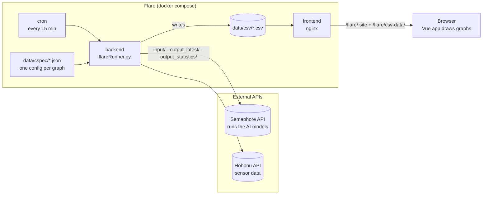
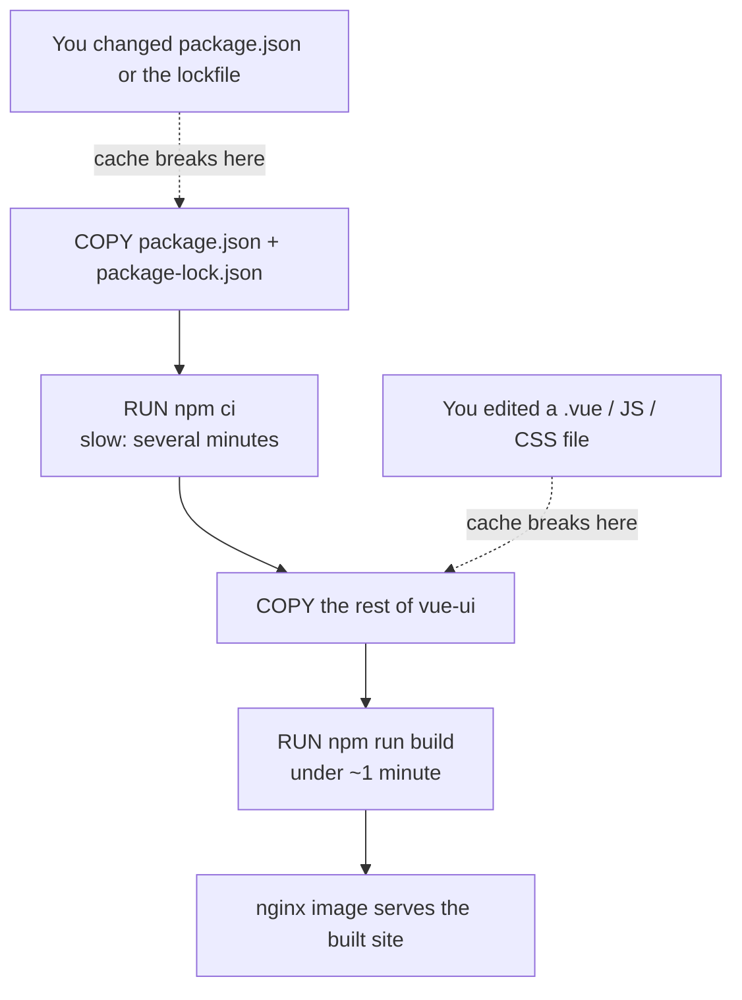
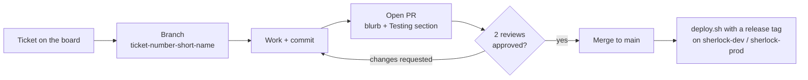
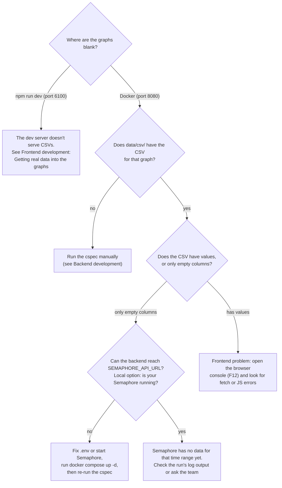

# Flare

## Description

Flare is a student-built and maintained web application that visualizes data generated by Artificial Intelligence models. Flare helps stakeholders and researchers track model progress, assess performance, and gain valuable information from AI outputs.

## Stuck?

**New here or stuck on a task? Start with the table below.**

## I need to...

| Task                                                 | Go to                                                                          |
| ---------------------------------------------------- | ------------------------------------------------------------------------------ |
| Set up Flare on my machine for the first time        | [First-time setup](#prerequisites)                                             |
| Understand how Flare and Semaphore work together     | [How Flare fits together](#how-flare-fits-together)                            |
| Change how a page looks or behaves (`.vue`, JS, CSS) | [Frontend development](#frontend-development-fast-loop)                        |
| Change how data is fetched or processed (Python)     | [Backend development](#backend-development)                                    |
| Add a new graph/data source                          | [Backend development](#backend-development) → cspec files                      |
| Check my work the way it will run in production      | [Run the full app with Docker](#run-the-full-app-with-docker-production-check) |
| Review a teammate's PR                               | [Reviewing a PR](#reviewing-a-pr)                                              |
| Open a PR for my ticket                              | [Team rules and opening a PR](#team-rules-and-opening-a-pr)                    |
| Figure out why something is broken or slow           | [Troubleshooting](#troubleshooting)                                            |

## How Flare fits together

<details>
<summary>How Flare gets its data from Semaphore, data flow diagram, and what each folder does</summary>

Flare doesn't run any AI models itself. The models run in **Semaphore**, a separate
project with its own API. Flare is the display side: it asks Semaphore for data and turns it into graphs.



How a graph gets its data:

1. On a schedule (every 15 min on the servers), Flare's backend reads a config file (a "cspec")
   that says which data a graph needs.
2. It requests that data from the Semaphore API, using the base URL in `SEMAPHORE_API_URL` (`.env`):
   - `input/`: observed measurements (e.g. measured water level), by source, series, location and time range
   - `output_latest/`: the most recent model predictions
   - `output_statistics/`: model performance statistics (e.g. CRPS)
3. It combines and processes the results, then writes one CSV per graph to `data/csv/`.
4. The Vue frontend loads those CSVs and draws the graphs.

Semaphore runs its models at 20 minutes past each hour (`VITE_MODEL_RUN_TIME`), so new predictions
appear after that. Some graphs also use the **Hohonu** API for sensor data (needs `HOHONU_API_AUTH`).

The browser never talks to Semaphore directly; only Flare's backend does.
If Semaphore is unreachable, the backend still writes CSVs, but with empty columns, and graphs show up blank.

What each folder does:

- **`backend/`**: Python code. `flareRunner.py` reads a cspec from `data/cspec/`, pulls data, and writes a CSV to `data/csv/`. On the server, [flare.cron](flare.cron) runs it every 15 minutes.
- **`data/cspec/`**: one JSON config per graph/data product.
- **`data/csv/`**: the generated CSVs. Mounted into both containers.
- **`vue-ui/`**: the Vue 3 + Vite frontend. Pages live in `vue-ui/src/views/`.
- **`Dockerfile.backend`**, **`Dockerfile.frontend`**, **`docker-compose.yml`**: how the two containers are built and run.
- **`nginx.conf`**: serves the built frontend and the CSV files.
- **`deploy.sh`**: deploy script used on the servers.

</details>

## Prerequisites

- **Docker Desktop**: installed and running.
  - Install guide: https://docs.docker.com/desktop/setup/install/windows-install/
- **WSL2**: Docker Desktop on Windows runs containers on WSL2 and installs it for you. Running `docker compose` and `npm run dev` from PowerShell works fine for local development. Use a WSL (Linux) terminal if you need Linux-accurate file permissions or need to run the bash scripts (`deploy.sh`), which matches how the servers run.
  - Install guide: https://learn.microsoft.com/en-us/windows/wsl/install
- **NVM + Node.js 22.10.0**: only needed for local frontend development. Use NVM in WSL/Linux, or **nvm-windows** in PowerShell. See [Frontend development](#frontend-development-fast-loop).

## First-time setup

0. Have the Prerequisites installed.
1. Clone the repo and `cd` into it (the folder is named `Flare`).
   - `git clone https://github.com/conrad-blucher-institute/Flare.git`
   - `cd Flare`
2. Create your `.env` file in the project root:
   - Copy `.env.dist` to `.env`: `cp .env.dist .env`
   - Fill in the values. `SERVICE_ACCOUNT_USERNAME` and `SERVICE_ACCOUNT_UID` must be set or the backend build fails. The UID must be between 1000 and 60000. Ask a teammate if unsure.
   - `FRONTEND_HOST_PORT` (default `8080`) is the port you'll open in your browser.
   - `SEMAPHORE_API_URL` is where the backend fetches its data from. Pick one (keep the others commented out with `#`):
     ```
     # SEMAPHORE_API_URL="https://sherlock-dev.tamucc.edu/semaphore-api/"   # dev Semaphore (default; use this unless told otherwise)
     # SEMAPHORE_API_URL="https://sherlock-prod.tamucc.edu/semaphore-api/"  # prod Semaphore
     SEMAPHORE_API_URL="http://host.docker.internal:8888/"                  # your own local Semaphore on port 8888
     ```
     `host.docker.internal` lets the backend container reach your own machine. Only use the local option when you're running Semaphore yourself.
     This setting only affects the backend; the frontend reads the CSVs the backend writes.
3. Make sure Docker Desktop is running, then follow [Run the full app with Docker](#run-the-full-app-with-docker-production-check).

## Run the full app with Docker (production check)

<details>
<summary>Build and run Flare like the servers do, useful Docker commands, expected build times</summary>

This builds and runs Flare the same way the servers do. Use it for your **final check before opening or approving a PR**. For day-to-day frontend work, the [fast loop](#frontend-development-fast-loop) is much quicker.

```bash
docker compose up -d --build     # build images and start containers in the background
```

Open http://localhost:8080/flare/ (or whatever `FRONTEND_HOST_PORT` is set to).

Useful commands:

| Command                           | What it does                                                                                |
| --------------------------------- | ------------------------------------------------------------------------------------------- |
| `docker compose build`            | Builds the images only. Doesn't start or restart anything.                                  |
| `docker compose up -d --build`    | Builds, then starts or recreates the containers that changed. Use this after changing code. |
| `docker compose up -d`            | Starts the containers from the images you already have, without rebuilding.                 |
| `docker compose down`             | Stops and removes the containers. Your CSVs in `data/csv/` are kept.                        |
| `docker compose logs -f frontend` | Streams the logs for one service (`frontend` or `backend`).                                 |
| `docker compose ps`               | Shows which containers are running.                                                         |

You don't need to run `docker compose down` before rebuilding. `up -d --build` replaces the containers that changed.

<details>
<summary>How long should a build take?</summary>

Docker caches each step. A step re-runs only if the files it depends on changed, and **every step after it re-runs too**. This is based on file contents, not on which branch you're on.

The frontend build steps, in order:



| What changed since your last build                               | Expected time                                                                                          |
| ---------------------------------------------------------------- | ------------------------------------------------------------------------------------------------------ |
| Nothing                                                          | a few seconds                                                                                          |
| Backend Python files only                                        | a few seconds                                                                                          |
| Frontend files (`.vue`, JS, CSS)                                 | under ~1 minute (the whole frontend is re-bundled into static files for nginx, but `npm ci` is reused) |
| `vue-ui/package.json` / `package-lock.json`, or first build ever | several minutes (`npm ci` runs from scratch)                                                           |
| `requirements.txt`                                               | longer (`pip install` runs again)                                                                      |

So switching branches to review a PR is only slow when that branch changed dependencies. If a build that should be fast is slow, check the build output: steps marked `CACHED` were reused.

The frontend always rebuilds as a whole because `vite build` bundles the entire app into optimized static files. One changed component can change the output files of everything that imports it. If you want edits to show up instantly, use the [fast loop](#frontend-development-fast-loop).

</details>

</details>

## Frontend development (fast loop)

<details>
<summary>Run the Vue app locally with instant reload, get real data into the graphs, lint and tests</summary>

Run the Vue app on your machine with Vite's dev server. When you save a `.vue` file, the browser updates in under a second (hot module replacement), with no Docker rebuild.

### One-time setup

Install Node **22.10.0**, the same version as the frontend container. Pick the option for the terminal you use.

**WSL / Linux (NVM):**

```bash
curl -o- https://raw.githubusercontent.com/nvm-sh/nvm/v0.39.1/install.sh | bash
# if that fails: curl https://raw.githubusercontent.com/nvm-sh/nvm/v0.39.1/install.sh | bash
nvm install 22.10.0
nvm use 22.10.0
node -v                  # should print v22.10.0
```

**Windows PowerShell (nvm-windows):**

```powershell
winget install CoreyButler.NVMforWindows   # or download the installer from https://github.com/coreybutler/nvm-windows/releases
# close and reopen PowerShell, then:
nvm install 22.10.0
nvm use 22.10.0
node -v                  # should print v22.10.0
```

### Every time

```bash
cd vue-ui
npm install              # first time, and whenever package.json changes
npm run dev              # starts the dev server
```

Open http://localhost:6100/flare/ in your browser. Press `r` in the terminal to restart the server and `q` to quit.

### Getting real data into the graphs

The pages load CSVs from `${window.location.origin}/flare/csv-data/...`. The dev server (port 6100) doesn't serve those files, so **graphs are empty under `npm run dev` until you point them at the Docker nginx**:

1. Keep the Docker containers running (`docker compose up -d`). nginx serves the CSVs on port 8080 and already allows requests from `localhost:6100`.
2. In the view you're working on, temporarily change the CSV URL to use port 8080, for example:
   ```js
   const csvURL = ref(`http://localhost:8080/flare/csv-data/CRPS_120hrs.csv`);
   ```
3. **Revert this before committing.** In production, the URL must use `window.location.origin`.

If `data/csv/` is empty on your machine, generate a CSV by running the backend once (see [Backend development](#backend-development)).

### Frontend checks

```bash
npm run lint             # ESLint (auto-fixes what it can)
npm run format           # Prettier
npm run test:unit        # Vitest unit tests
npm run test:e2e:dev     # Cypress end-to-end tests against the dev server
```

When the change looks right in the dev server, do a final [Docker production check](#run-the-full-app-with-docker-production-check). Some issues only show up in the built version, such as wrong asset paths under `/flare/` or the env value `VITE_MODEL_RUN_TIME`.

</details>

## Backend development

<details>
<summary>Apply changes, run a data product manually, run tests, add a new graph</summary>

The backend container doesn't run a server. It stays idle, and `flareRunner.py` is run inside it (by cron on the servers, or by you when testing).

**Apply your code changes:** `docker compose up -d --build`. Backend-only rebuilds take a few seconds.

**Run one data product manually** (writes or overwrites its CSV in `data/csv/`):

```bash
docker exec flare-backend python3 /app/backend/flareRunner.py -v -c /app/data/cspec/<cspec-name>.json
# e.g.
docker exec flare-backend python3 /app/backend/flareRunner.py -v -c /app/data/cspec/CRPS_120hrs.json
```

See [flare.cron](flare.cron) for every cspec the servers run.

**Run the backend tests:**

```bash
docker exec flare-backend python3 -m pytest /app/backend/Tests
```

**Adding a new graph/data source:** add a cspec JSON in `data/cspec/`, add a matching line to [flare.cron](flare.cron) (keep the empty line at the end of that file), and point the frontend view at the new CSV name.

</details>

## Reviewing a PR

<details>
<summary>Step-by-step checklist for reviewing a teammate's PR</summary>

1. `git fetch` and `git checkout <their-branch>`.
2. Follow the **Testing** section in the PR description.
3. Frontend PR: try it in the [fast loop](#frontend-development-fast-loop), then do the [Docker check](#run-the-full-app-with-docker-production-check).
4. Backend PR: `docker compose up -d --build`, run the affected cspec manually, and run the tests.
5. Check the code follows the [team rules](#team-rules-and-opening-a-pr): types, docstrings, file headers, and tests for new features.
6. When done, `git checkout` back to your branch and run `docker compose up -d --build`.

</details>

## Team rules and opening a PR

<details>
<summary>PR requirements (2 reviews, Testing section, docs, tests) and the typical git flow</summary>



- A ticket that requires code is finished with a PR. **PRs need two reviews from other developers** before being merged.
- Every PR description includes:
  - a short blurb on **how** the task was completed
  - a **Testing** section telling teammates exactly how to test it
- Any new feature must have tests.
- Functions require Pylance type annotations and documentation (docstrings).
- Files require a file header.
- **Nothing is published to dev without going through a PR first.**
- **No manual edits on sherlock-dev or sherlock-prod.** Changes reach the servers only through a merged PR and `deploy.sh`.

Typical flow:

```bash
git checkout main && git pull
git checkout -b <ticket-number>-<short-description>
# ...work, commit...
git push -u origin <branch-name>
# open the PR on GitHub, fill in the blurb + Testing section, request 2 reviewers
```

</details>

## Deployment (servers only)

<details>
<summary>How code reaches sherlock-dev / sherlock-prod</summary>

On the server, `./deploy.sh <tag>` checks out the given git tag, rebuilds and restarts the containers, and reinstalls the cron schedule from `flare.cron`. Don't edit files on the servers by hand.

</details>

## Troubleshooting

<details>
<summary>Common errors and how to fix them, including a "why are my graphs blank?" guide</summary>

### Why are my graphs blank?



### Common errors

| Problem                                                                                      | Likely cause / fix                                                                                                                                                                                                                                         |
| -------------------------------------------------------------------------------------------- | ---------------------------------------------------------------------------------------------------------------------------------------------------------------------------------------------------------------------------------------------------------- |
| Backend build fails with `SERVICE_ACCOUNT_USERNAME and SERVICE_ACCOUNT_UID must be provided` | `.env` is missing or those values are empty. See [First-time setup](#first-time-setup).                                                                                                                                                                    |
| Graphs are empty under `npm run dev`                                                         | CSVs aren't served on port 6100. See [Frontend development](#frontend-development-fast-loop) → "Getting real data into the graphs".                                                                                                                        |
| Graphs are empty in Docker                                                                   | `data/csv/` has no CSV for that graph, or the data source returned nothing. Run the cspec manually and check its output.                                                                                                                                   |
| Every graph is empty/blank after running a cspec                                             | The backend couldn't reach Semaphore. Check `SEMAPHORE_API_URL` in `.env`: if it's the local `host.docker.internal:8888` option, your local Semaphore must be running. After changing `.env`, run `docker compose up -d` so the backend picks it up. |
| A build takes minutes when you only changed a `.vue` file                                    | Check whether `npm ci` shows `CACHED`. If it doesn't, check that `package.json` / `package-lock.json` didn't change on your branch.                                                                                                                        |
| Port already in use                                                                          | Another app (or an old container) is using `8080` or `6100`. Run `docker compose down` or change `FRONTEND_HOST_PORT` in `.env`.                                                                                                                           |
| Changes don't appear in Docker                                                               | Did you rebuild? `docker compose up -d --build`. Hard-refresh the browser (Ctrl+Shift+R).                                                                                                                                                                  |

</details>

## Authors

- [@Anointiyae Beasley](https://github.com/abeasley1722) - anointiyae.beasley@tamucc.edu
- [@Matthew Kastl](https://github.com/matdenkas) - mkastl@islander.tamucc.edu
- [@Beto Estrada](https://github.com/bestrada33) - bestrada4@islander.tamucc.edu
- [@Savannah Stephenson](https://github.com/lovelysandlonelys) - savannah.stephenson@tamucc.edu
- [@Jeremiah Sosa](https://github.com/jeremiahsosa77) - jsosa14@islander.tamucc.edu
- [@Hector Marrero-Colominas](https://github.com/Nextgun) - hector.marrero@tamucc.edu
- [@Ayesha Khan](https://github.com/akhan994) - akhan4@islander.tamucc.edu
- [@Florence Tissot](https://github.com/ccftissot)
